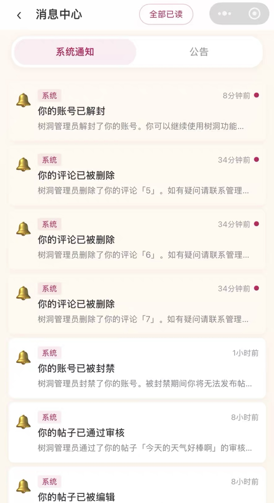
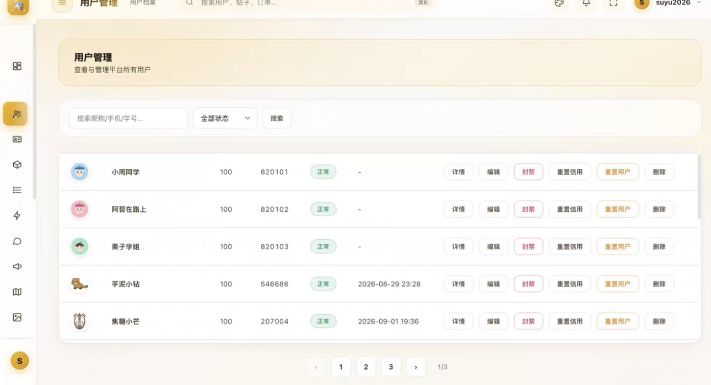
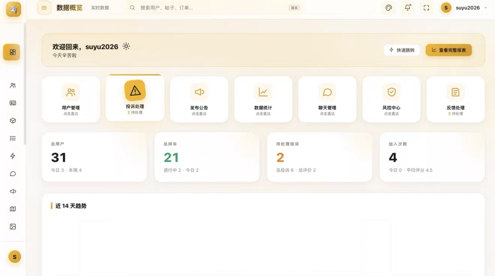

# 校园综合服务平台（校园服务平台 · 校园同行）

> 一套**完整可上线**的校园生活服务微信小程序源码，包含：微信小程序前端 + Node.js 后端 + 网页管理后台。
> 以「拼车出行」为核心，扩展 **17 个校园生活服务入口**，内置用户系统、信用分、实时私信/群聊、内容风控与管理后台。

---

## 一、项目简介

本项目是一套面向高校的校园综合服务小程序（品牌名「**校园服务平台**」，导航标题「**校园同行**」）。学生可发布/加入拼车、使用快递代取、二手交易、失物招领、校园论坛、树洞、校园互助墙等模块，并在统一的信用分体系下互相评价。配套管理后台支持用户管理、内容审核、投诉处理、风控与运营统计。

小程序端为微信原生框架（WXML + WXSS + JS），5 个自定义 TabBar（首页 / 互助 / 发布 / 消息 / 我的），主包 5 个页面 + 分包 **80 个页面**，覆盖校园生活全场景。

源码已对个人、账号与学校相关信息做脱敏处理。配置项以 `{{...}}`、`change_me...`、`touristappid` 或“示例”数据保留，部署前需替换为你的实际值（见下文「配置占位符」）。`app.suyu.ink` 仅作为域名链接示例保留。

---

## 界面预览

### 小程序端

| 首页 | 互助墙 |
|:---:|:---:|
|  |  |

### 功能与后台

| 功能展示 | 管理界面 | 服务入口 |
|:---:|:---:|:---:|
|  |  |  |

> 以上为项目运行示例截图（演示数据），完整界面以实际部署为准。

---

## 二、功能特性

### 核心功能：拼车出行
- 发布拼车（出发地 / 目的地 / 时间 / 人数 / 费用）
- 同行大厅：浏览、搜索、筛选拼车信息
- 申请加入、管理同行成员
- 完成后互相评价（信用分机制）
- 热门路线推荐、出行偏好标签（抽烟 / 听歌 / 聊天 / 安静 / 宠物 / 行李）
- 拼车状态自动流转（进行中 / 已满员 / 已结束 / 已取消 / 已过期），过期任务自动关闭

### 首页（pages/index）一站式聚合
- **校园图片轮播横幅**：5 张 Banner 自动轮播 + 自定义指示点，直达发布中心
- **公告横条轮播**：置顶公告 5 秒自动切换（渐隐渐显），点击进入公告详情
- **功能宫格**：17 项服务入口，左右两屏滑动（第一屏 10 项 + 第二屏 7 项），3D 拟物图标
- **校园互助墙**：聚合拼车 / 跑腿 / 快递 / 二手 / 失物 / 任务 / 论坛帖子，支持 10 个分类 Tab（最新 / 日常投稿 / 话题 / 表白寻人 / 二手 / 答疑 / 吐槽 / 失物寻物 / 拼车 / 求助），卡片带热度、拼车座位状态、取件码高亮、图片多图展示
- **帖子卡片交互**：按压缩放动效 + 震动反馈，滑动不误触；点赞走真实后端接口（用户级去重、可取消）、评论跳详情、卡片「⋯」支持不展示/举报
- **活动 / 公益 / 食堂推荐**：动态数据卡片（无数据自动隐藏），食堂推荐默认取评分最高档口
- **全局搜索**：一次搜索拼车 + 跑腿 + 快递三个模块，结果按类型着色展示
- **分享**：支持转发给朋友 + 分享到朋友圈，分享卡片直达对应分包页面
- **扫码**：顶部扫码入口（wx.scanCode）

### 17 个校园生活服务入口
| 模块 | 标识 | 说明 |
|------|------|------|
| 校园拼车 | carpool | 拼车出行（核心模块） |
| 代取代送 | express | 快递代拿 / 代寄，取件码绿色高亮 |
| 二手市场 | secondhand | 二手物品买卖 |
| 物品租求 | rental | 物品租借 / 短租 |
| 失物招领 | lost | 拾到 / 丢失物品发布 |
| 常用工具 | tools | 学生办事工具集（证件照 / 医保 / 贷款 / 报销 / 奖学金 / 补办卡等） |
| 校园地图 | map | 校园手绘地图、楼栋导航、实时定位 |
| 校历查询 | calendar | 学期校历 |
| 信息公告 | announcement | 活动公告 / 通知 |
| 食堂推荐 | food | 食堂档口评分与推荐 |
| 校园题库 | questionbank | 题库查询与发布 |
| 校园图鉴 | guide | 校园地标 / 组织 / 动物 / 植物 / 奖项 / 证书图鉴 |
| 校园成就 | achievement | 成就系统（打卡解锁） |
| 兼职专区 | parttime | 校园兼职信息 |
| 校园活动 | activity | 活动报名（复用公告体系） |
| 常用电话 | phone | 校园黄页（电话本） |
| 校园论坛 | forum | 校园话题讨论（7 大分类） |

### 用户系统
- 微信一键登录 / 静默登录（启动自动换取 JWT）
- 手机号绑定、个人资料（头像、昵称、学校、院系、年级、学号）
- 信用分机制（初始 100，发布 +5、参与 +2、好评 +3、差评 -5、爽约 -10）
- 实时私信、基于拼车的群聊、在线状态
- 统一未读轮询（5 秒一次，TabBar 角标 = 通知 + 私信，快递任务独立角标）
- 投诉 / 反馈 / 联系我们

### 管理后台（Web，原生 SPA）
- 数据概览仪表盘
- 用户管理（搜索、封禁、解封）
- 拼车 / 公告 / 帖子管理
- 投诉处理、反馈管理、评价管理
- 聊天记录查看、操作日志
- IP 风控、敏感词管理
- 论坛分类管理、兼职信息管理

---

## 三、技术栈

| 层级 | 技术 | 版本 |
|------|------|------|
| 后端框架 | Node.js + Express.js | 4.x |
| 数据库 | MySQL | 5.7+ |
| 认证 | JWT（jsonwebtoken + bcryptjs） | 9.x |
| 图片处理 | sharp（缩略图 / 压缩） | 0.35.x |
| 小程序 | 微信小程序原生框架 | WXML + WXSS + JS |
| 管理后台 | 原生 HTML / CSS / JS SPA（ES Modules） | — |
| 部署 | PM2 + Nginx 反向代理 | — |
| SSL | Let's Encrypt（certbot / acme.sh） | — |

### 后端主要依赖
express · mysql2 · jsonwebtoken · bcryptjs · multer · helmet · cors · morgan · express-rate-limit · express-validator · axios · dayjs · dotenv · sharp

---

## 四、目录结构

```
项目根目录/
├── README.md                       # 本文档
├── backend/                        # 后端服务
│   ├── .env.example                # 环境变量模板（部署时 cp 为 .env）
│   ├── install.sql                 # 一键建库脚本（含全部表结构与种子数据）
│   ├── schema.sql                  # MySQL 建表脚本（核心表）
│   ├── schema-module.sql           # 模块系统建表脚本
│   ├── schema-treehole.sql         # 树洞模块建表（4 张表）
│   ├── schema-new-tables.sql       # 新增表（黄页 / 题库 / 图鉴 / 成就等）
│   ├── schema-canteen.sql          # 食堂模块建表
│   ├── schema-map-pois.sql         # 地图 POI 建表
│   ├── seed-new-tables.sql         # 种子数据
│   ├── migrations/                 # 增量迁移脚本（论坛独立、拼车统一等）
│   ├── admin/                      # 管理后台 SPA（index.html 等）
│   ├── uploads/                    # 用户上传目录
│   └── src/                        # 后端源码
│       ├── app.js                  # Express 主入口
│       ├── config/                 # 数据库等配置
│       ├── middleware/             # 认证 / 权限 / 隐私脱敏 / 限流
│       ├── models/                 # 数据模型（自研 QueryBuilder）
│       ├── controllers/            # 控制器（业务逻辑）
│       ├── routes/                 # 路由
│       └── services/               # 服务层（统计 / 风控 / 短信 / 微信推送）
│
├── mini-program/                   # 微信小程序
│   ├── project.config.json         # 开发者工具项目配置
│   ├── API接口文档.md              # API 接口详细文档
│   ├── 隐私保护指引.txt            # 隐私保护指引（联系方式已脱敏）
│   ├── scripts/                    # 页面生成脚本
│   └── miniprogram/                # 小程序主体
│       ├── app.js / app.json       # 入口与全局配置（含未读轮询、静默登录、外观设置）
│       ├── utils/api.js            # API 封装（REST 客户端）
│       ├── components/             # 复用组件（hall-view / mine-view / msg-view / publish-view）
│       ├── pages/                  # 主包页面（首页 / 互助 / 发布 / 消息 / 我的）
│       ├── subpkg/                 # 分包页面（80 个）
│       └── images/                 # 图片资源
│
└── 方法与总结/                     # 开发参考文档
    ├── README.开发文档.md          # 更详细的技术 / 开发参考
    ├── REPLACE_PLACEHOLDERS.md     # 占位符清单与替换说明（必读）
    ├── 部署流程.md                 # 按步骤操作的快速部署清单
    ├── 小程序修改工作流程.md       # 小程序修改参考（可喂给 AI）
    └── 微信订阅消息通知接入指南.md  # 订阅消息接入
```

---

## 五、环境要求

- Node.js 18+
- MySQL 5.7+
- 微信开发者工具（用于小程序调试 / 预览）
- 一台可公网访问的服务器（部署阶段，可选）

---

## 六、快速开始（本地开发）

### 1. 初始化数据库
```bash
mysql -u root -p < backend/install.sql
```
> `install.sql` 为合并脚本，已含全部表结构与种子数据；如需单独建表，可分别执行 `schema.sql` / `schema-module.sql` / `schema-treehole.sql` / `schema-new-tables.sql` / `schema-canteen.sql` / `schema-map-pois.sql`。

### 2. 配置后端环境变量
```bash
cd backend
cp .env.example .env
# 编辑 .env，至少填写：MYSQL_PASSWORD、JWT_SECRET、WECHAT_APPID、WECHAT_SECRET
```

### 3. 安装依赖并启动后端
```bash
npm install
npm run dev      # 开发模式（nodemon 热重载）
# 或
npm start        # 生产模式
```
后端默认运行在 `http://localhost:3000`，健康检查：`GET /api/health`

### 4. 小程序开发
```text
用「微信开发者工具」打开 mini-program/ 目录，
在 project.config.json 中填入你自己的小程序 AppID，
并将 miniprogram/utils/api.js 中的 API_BASE 指向本地后端（默认 https://app.suyu.ink）。
```

### 5. 管理后台
浏览器访问 `http://localhost:3000/admin`
默认账号：`admin` / `Admin@123456`（**上线前务必修改**）

---

## 七、API 概览

所有接口前缀为 `/api`，鉴权方式：
```
Authorization: Bearer <JWT_TOKEN>
```

| 路由 | 说明 | 认证 |
|------|------|------|
| /api/auth | 登录 / 注册 / Token | 部分 |
| /api/user | 用户资料 / 搜索 / 统计 | JWT |
| /api/carpools | 拼车 CRUD（统一拼车接口） | JWT |
| /api/carpool-tags | 拼车出行偏好标签 | 无 |
| /api/messages · /api/messages/enhanced | 私信 / 群聊 / 在线状态 | JWT |
| /api/group-chat | 基于拼车的群聊 | JWT |
| /api/notifications | 通知 | JWT |
| /api/reviews | 评价 | JWT |
| /api/announcements | 公告 / 活动 | JWT |
| /api/complaints | 投诉 | JWT |
| /api/feedback | 反馈 | JWT |
| /api/upload | 文件上传 | JWT |
| /api/admin | 管理后台全部功能 | 管理员 |
| /api/contact | 联系我们 | 无 |
| /api/module | 模块帖子（多模块统一 CRUD + 点赞 + 接单） | JWT |
| /api/remark | 备注 | JWT |
| /api/forum | 论坛帖子（独立体系 + 分类 + 点赞） | JWT |
| /api/treehole | 树洞（匿名倾诉） | JWT |
| /api/wall | 校园互助墙聚合流 | 可选 |
| /api/guide | 校园图鉴 | JWT |
| /api/guide-checkin | 图鉴打卡（成就关联） | JWT |
| /api/map | 校园地图 POI | JWT |
| /api/canteen | 食堂档口 / 评价 | 无 |
| /api/achievement | 成就系统 | JWT |
| /api/reference | 参考资料 | — |
| /api/sticker | 表情包 | — |
| /api/recommend | 热门推荐 | 无 |
| /api/health | 健康检查 | 无 |

更详细的字段说明见 `mini-program/API接口文档.md`。

---

## 八、数据库

共 **36 张表**，分为：
- **核心业务表**：users · carpools · carpool_participants · messages · notifications · reviews · complaints · complaint_timeline · feedbacks · announcements · favorites
- **模块系统表**：module_posts · module_favorites · module_replies
- **树洞表**：treehole_posts · treehole_likes · treehole_comments · treehole_reports
- **论坛 / 内容表**：forum 相关（见 migrations/forum-independent-20260817.sql）
- **校园特色表**：canteens · canteen_stalls · stall_reviews · map_pois · yellowpages · questionbanks · guide_categories · guide_items · guide_checkins（图鉴打卡）· achievement_items · achievement_tracks · user_achievements
- **辅助表**：admins · sensitive_words · ip_records · hot_routes · daily_stats · operation_logs · contact_messages · sms_codes

> 建库请用合并脚本 `backend/install.sql`（`mysql -u root -p < backend/install.sql` 一键建库，已含全部表结构与种子数据）。
> 默认超级管理员账号：`admin` / 默认密码 `Admin@123456`（已写入 `install.sql`，建库后即可直接登录；**上线前务必修改为强密码**）。
> 后续增量更新请按顺序执行 `backend/migrations/` 下的迁移脚本。

---

## 九、配置占位符（部署前必读）

源码中的敏感 / 个性化信息已改为占位符或通用演示数据，**部署到你的环境前必须全文检查并替换**：

- `app.suyu.ink` — 保留的演示域名（`mini-program/miniprogram/utils/api.js` 中的 `API_BASE` 一并替换）
- `示例大学` / `示例市` / `0000` / `{{SCHOOL_ADDRESS}}` / `{{SCHOOL_EMAIL_DOMAIN}}` — 学校相关信息
- `touristappid` / `change_me_to_your_wechat_appid` / `change_me_to_your_wechat_secret` — 微信小程序凭证（`project.config.json` 与 `.env.example`）
- `{{WECHAT_TEMPLATE_ID}}` — 微信订阅消息模板 ID（utils/api.js 中 `NOTIFY_TEMPLATE_ID`）
- `change_me_to_a_random_long_string` / `change_me_to_a_database_password` — JWT 密钥与数据库密码
- `{{SERVER_IP}}` / `{{USER_HOME}}` / `{{PM2_PROCESS_NAME}}` — 服务器与本地路径
- `{{DEVELOPER_PHONE}}` / `{{DEVELOPER_EMAIL}}` — 隐私保护指引中的联系方式
- `change_me_to_a_strong_password` — 树洞管理后台密码（backend/.env 的 `TREEHOLE_ADMIN_PASSWORD`）
- `/images/qr-placeholder.png` — 二维码占位图；上线前替换为自己的群聊、全景或联系二维码
- `campus-map_2k.jpg` / `campus-map_8k.jpg` — 校园地图示例路径；需提供自己的地图并重新标定坐标

完整清单与填写示例见 **`方法与总结/REPLACE_PLACEHOLDERS.md`**。

---

## 十、部署说明

- **`方法与总结/部署流程.md`** — 按步骤操作的快速部署清单（推荐先看这份）；
- **`方法与总结/README.开发文档.md`** — 更详细的技术参考（含 Nginx 反向代理、PM2 进程管理、HTTPS 证书、数据库备份等）。

通用流程：
1. 服务器安装 Node.js + MySQL + Nginx；
2. 上传 `backend/` 并 `npm install --production`；
3. 创建数据库并导入 `install.sql`（或逐个导入 schema 脚本）；
4. 配置 `.env`（替换全部占位符）；
5. 用 PM2 启动，配置 Nginx 反向代理与 HTTPS；
6. 微信开发者工具上传小程序，填入你的 AppID，并将 `API_BASE` 指向你的域名。

---

## 十一、相关文档

- `方法与总结/REPLACE_PLACEHOLDERS.md` — 占位符清单与替换说明（**部署前必读**）
- `方法与总结/部署流程.md` — 按步骤操作的快速部署清单
- `方法与总结/README.开发文档.md` — 更完整的技术 / 开发参考文档
- `方法与总结/小程序修改工作流程.md` — 小程序修改参考（可喂给 AI）
- `mini-program/API接口文档.md` — API 接口详细文档
- `方法与总结/微信订阅消息通知接入指南.md` — 微信订阅消息接入

---

## 十二、许可证

本仓库为**商业交付源码**，随项目整体转让。具体授权范围、是否允许转售 / 二开，以买卖双方签署的协议为准。
